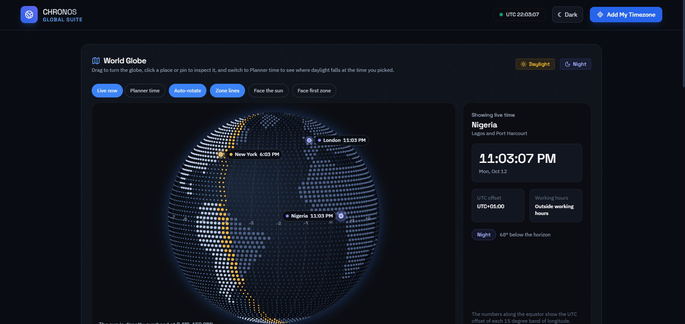

# Chronos

Chronos is a world time zone planner that keeps live clocks, a day and night map, and a meeting overlap planner on one page. Open it, add the cities you work with, and see at a glance who is awake. Your zones, working hours, and theme are stored in your browser, so there is no account to create and nothing to sync.

**[Live Demo](https://crypticot.github.io/chronos/)**



---

## Why this exists

Scheduling a call across time zones usually means doing arithmetic in your head and hoping daylight saving has not shifted anything. The part that actually helps is small: a few live clocks side by side, a way to slide through the day and see who is in working hours, and a plain statement of who is ahead of whom.

Chronos sticks to that. The whole app is a single file with no server behind it. There is no sign-up, no analytics, and nothing to configure before you can compare two cities.

---

## What it does

- **Live clock board**: each zone shows its own time with seconds, the date, its UTC offset, and whether it is day or night there. Nigeria is one of the default zones, alongside New York, London, Tokyo, and Sydney
- **Drag to reorder**: drag a zone card to rearrange the board. Your order is remembered
- **Every time zone**: the dropdown lists every zone your browser knows, sorted by current UTC offset from negative to positive, then alphabetically. An "Add my time zone" button picks up your own zone automatically
- **Day and night map**: a dot-matrix world map shaded from the real position of the sun, with an amber line along sunrise and sunset. Active zones appear as pins
- **Meeting overlap planner**: slide through the day and see the same moment in every zone, with each one marked as working hours, off hours, or night. Drag the rows to reorder them. The first zone sets the slider's clock
- **Your own working hours**: set when the working day starts and ends, or reset to the default of 9 AM to 6 PM. A day that crosses midnight works too
- **Time converter**: enter a date and time in one zone and see it in another, with the date written out in full
- **Clear time gaps**: the gap between two zones names who is ahead, for example "Tokyo is 9 hours ahead of Nigeria", including half-hour offsets such as India
- **Light and dark themes**: dark by default, and your choice is remembered
- **Works on phones**: the layout stacks on narrow screens, and the planner rows reflow so the times and status labels stay readable

---

## Tech stack

Built in vanilla HTML, CSS, and JavaScript, in one file. Just open `index.html`.

- No build step and no framework
- Tailwind CSS and Lucide icons load from public CDNs
- Time zone and daylight saving rules come from the browser's own `Intl` support, so nothing is hard-coded
- The map is drawn on a `<canvas>`
- Browser storage (`localStorage`) keeps your zones, working hours, and theme on your device
- Google Fonts: Space Grotesk (headings and numbers) + IBM Plex Sans (body), with system fonts as the fallback

---

## Running it locally

```bash
git clone https://github.com/crypticot/chronos.git
cd chronos
```

Open `index.html` in any modern browser. No dependencies to install, no server required.

---

## A few design decisions worth knowing

**Why offsets come from the browser instead of a table.** Daylight saving rules change by country and by year. Chronos asks the browser's time zone database for each zone's offset at the moment it needs it, so the clocks, the converter, and the gap between two zones stay correct without the code carrying its own list of offsets. The zone list sorts by today's offset, so it reflects daylight saving as it is right now.

**Why the converter treats your input as local to the source zone.** A date and time picker only gives a bare value, with no zone attached. Chronos reads it as a wall-clock time in the zone you chose, works out the exact moment that represents, and then shows that moment in the target zone. This is what keeps the result right around daylight saving changes.

**Why the planner follows the first zone.** The slider needs one reference clock. Using the first card means you choose it by dragging, and the planner always says whose time you are moving through.

**Why the map is made of dots.** The land is built from simplified outlines and drawn as a dot grid, which stays readable at small sizes without shipping a large map file. Day and night are calculated from the sun's declination and the time of day, so the shaded half is the real one.

**Known limits.** Drag and drop uses the browser's native dragging, which behaves differently on touch screens, so reordering can be unreliable on some phones. Map pins exist for around 25 major cities, and other zones still appear on the board without one. Older browsers that lack the full zone list fall back to a shorter default list.

---

## Built by

**Chidubem Ojukwu** · [Portfolio](https://crypticot.github.io/cotworks-portfolio/) · [LinkedIn](https://linkedin.com/in/ojukwuii)

Created by COTworks. A single-file tool for anyone who schedules across time zones, with nothing to sign up for.
